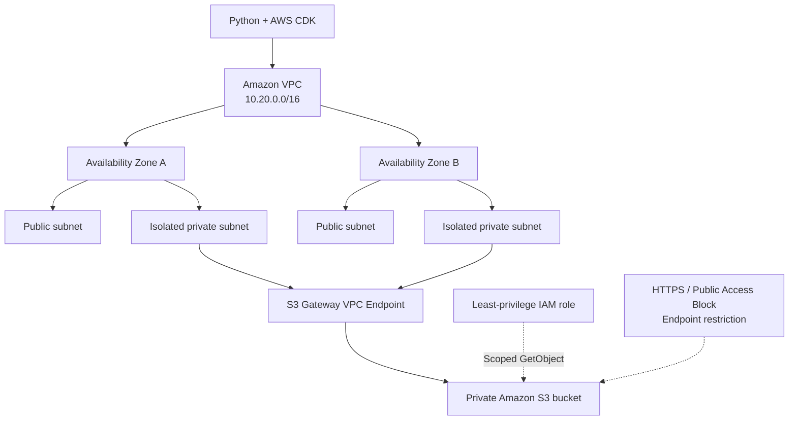

<div align="center">

# ☁️ SecureCorp AWS

### Secure Cloud Infrastructure · Infrastructure as Code · Security by Design

**A hands-on AWS architecture project focused on secure networking, private storage, and automated validation.**


[Architecture](#-architecture) · [Security](#-security-controls) · [Getting Started](#-getting-started) · [Validation](#-validation) · [Roadmap](#-roadmap)

</div>

---

## 🎯 Overview

**SecureCorp AWS** is a practical infrastructure-as-code portfolio project built with **AWS CDK and Python**. It explores network isolation, least-privilege access, secure object storage, and repeatable infrastructure validation.

> **Deployment status:** This repository defines and validates AWS infrastructure as code. Resources are **not claimed to be deployed** to a live AWS account.

## 🏗️ Architecture



### Architecture highlights

| Component | Design |
| --- | --- |
| **Amazon VPC** | `10.20.0.0/16`, spanning two Availability Zones |
| **Subnets** | Public and isolated private subnet tiers |
| **NAT Gateway** | Not provisioned in the current design |
| **S3 Gateway Endpoint** | Private route for S3 traffic from the isolated subnets |
| **Security Group** | Restrictive inbound and outbound rules |
| **IAM** | Scoped S3 object-read permissions |
| **S3** | Private bucket with encryption, versioning, and transport controls |

## 🔐 Security Controls

| Control | Implementation / intention |
| --- | --- |
| Block public S3 access | S3 Block Public Access enabled |
| Encrypt data at rest | S3 server-side encryption (AES-256) |
| Enforce encryption in transit | Bucket policy denies insecure transport |
| Object versioning | Enabled |
| Private network access | S3 Gateway Endpoint with endpoint-based policy restrictions |
| Least privilege | Narrowly scoped IAM permissions and security-group rules |
| Resource retention | Bucket retention policy configured |

> Security settings should be verified against the synthesized CloudFormation template and automated checks before any deployment. Network reachability alone does not validate application-level security.

## 🛠️ Tech Stack

- **Cloud:** Amazon Web Services (VPC, IAM, S3, VPC Endpoints)
- **Infrastructure as Code:** AWS CDK, CloudFormation
- **Language:** Python
- **Quality & Security:** Python tests and infrastructure security checks
- **Version control:** Git and GitHub

## 🚀 Getting Started

### Prerequisites

- Python 3
- Node.js and npm
- AWS CDK CLI (`npm install -g aws-cdk`)
- AWS credentials **only if** you intend to interact with an AWS account

### Local setup (PowerShell)

```powershell
git clone https://github.com/Gabriel-F4l/SecureCorp-AWS..git
cd SecureCorp-AWS.
python -m venv .venv
.\.venv\Scripts\Activate.ps1
python -m pip install -r requirements.txt
```

> The repository name currently ends with a period (`SecureCorp-AWS.`). This is intentional in the clone URL above.

### Synthesize infrastructure locally

```powershell
cdk synth
```

Some CDK context values, including the S3 prefix-list identifier, may need to be provided according to the project's configuration. Review `cdk.json` and the stack source before running synthesis.

## 🧪 Validation

The repository includes Python test code and a security-audit script. Inspect the scripts and their dependencies before running them.

```powershell
python -m pip install -r requirements-dev.txt
python -m pytest
python audit_security.py
```

A successful synthesis or test run validates specific definitions and assertions; it does **not** prove that the infrastructure has been deployed or penetration-tested.

## 📂 Project Structure

```text
SecureCorp-AWS/
├── app.py
├── audit_security.py
├── cdk.json
├── requirements.txt
├── requirements-dev.txt
├── secure_corp_aws/
├── tests/
└── README.md
```

## 🗺️ Roadmap

- [x] Define AWS infrastructure with Python CDK
- [x] Model a two-AZ VPC and isolated private subnet architecture
- [x] Add private S3 access and baseline security controls
- [x] Add security-oriented checks and tests
- [ ] Integrate GitHub Actions for automated tests and CDK synthesis
- [ ] Add automated static/security scanning
- [ ] Expand architecture documentation and operational runbooks
- [ ] Evaluate a controlled deployment and monitoring strategy

## 👨‍💻 About the Project

Built as a practical cloud-engineering portfolio project to demonstrate **Infrastructure as Code, secure AWS design, and engineering discipline**.

---

<div align="center">

**SecureCorp AWS — Build securely. Validate continuously.**

</div>
