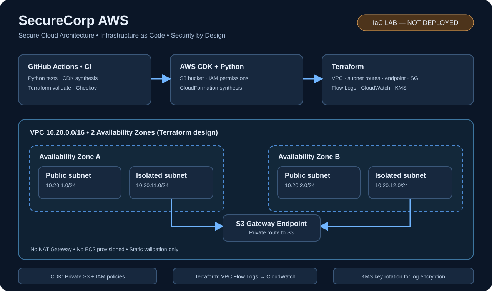
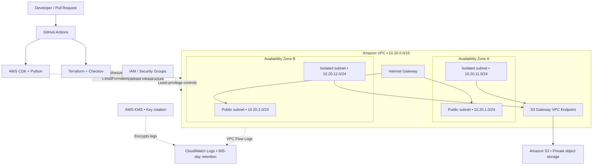

<div align="center">

# ☁️ SecureCorp AWS
### Secure Cloud Architecture • Infrastructure as Code • DevSecOps

**An AWS cloud-engineering lab designed with security in mind — from network isolation to automated quality gates.**


[**Architecture**](#-architecture) · [**Security**](#-security-by-design) · [**CI/CD**](#-automated-quality-gates) · [**Run locally**](#-getting-started) · [**Roadmap**](#-roadmap)

> **Lab status:** Infrastructure defined and tested as code. **No production deployment or live AWS workload is claimed.**

</div>

---

## ✨ At a glance

| 🧪 Python tests | 🛡️ Terraform security scan | ⚙️ Automation |
|:---:|:---:|:---:|
| **13 passed** | **40 passed · 0 failed · 1 documented skip** | **GitHub Actions CI** |
| Last reported local run | Last reported local Checkov run | CDK and Terraform workflows |

**SecureCorp AWS** is a portfolio lab exploring how to build a secure, auditable cloud foundation with **AWS CDK (Python)** and **Terraform**. Both IaC implementations live in this repository; they are **separate configurations**, not a single deployed stack.

## 🏗️ Architecture



*Architecture overview — infrastructure defined as code; not deployed.*




> **Architecture is illustrative, not a live topology.** The S3 bucket and scoped IAM permissions are modeled in the CDK portion; the VPC Flow Logs, KMS log encryption, and network resources shown above are defined in Terraform. The private subnets have no default internet route or NAT Gateway. Public subnets have an Internet Gateway route but do not assign public IPs automatically.

### Network foundation

| Layer | Design choice |
|---|---|
| **VPC** | `10.20.0.0/16`, two Availability Zones |
| **Public subnets** | `10.20.1.0/24` and `10.20.2.0/24` |
| **Isolated subnets** | `10.20.11.0/24` and `10.20.12.0/24` |
| **Private S3 access** | Gateway VPC Endpoint associated with the isolated route table |
| **Internet access** | No NAT Gateway; no default internet route in isolated subnets |
| **Security groups** | Deny-by-default ingress; scoped HTTPS egress to S3 prefix list |
| **Observability** | VPC Flow Logs to CloudWatch Logs with KMS and retention |

## 🔐 Security by design

| Control | Configuration |
|---|---|
| **S3 public access** | Block Public Access |
| **S3 encryption** | Server-side AES-256 encryption |
| **S3 transport** | Bucket policy denying insecure transport |
| **S3 resilience** | Object versioning and retention-oriented design |
| **Private connectivity** | S3 Gateway Endpoint for isolated subnets |
| **Least privilege** | Restricted IAM permissions and Security Group egress |
| **Network audit** | VPC Flow Logs capturing accepted and rejected traffic |
| **Log protection** | KMS encryption, automatic key rotation, 365-day log retention |
| **IaC scanning** | Checkov in the Terraform CI workflow |

**Known exception:** `CKV2_AWS_5` is explicitly skipped because the application Security Group is reserved for a future private EC2/ENI. This is **not** proof of remediation; remove the exception once the group is attached.

## ⚙️ Automated quality gates

Two GitHub Actions workflows are maintained:

| Workflow | Checks |
|---|---|
| [**AWS Security CI**](.github/workflows/security-ci.yml) | Python syntax, CDK synthesis, CloudFormation template inspection, Pytest, security audit; Bandit and Ruff as informational checks |
| [**Terraform CI**](.github/workflows/terraform-ci.yml) | `terraform init`, `fmt -check`, `validate`, Checkov scan |

> **No `terraform apply` or `cdk deploy` runs in these workflows.** Bandit and Ruff currently use `continue-on-error`, so their findings do not fail the pipeline.

## 🚀 Getting started

### Requirements

- Python 3.12 recommended; Node.js and npm
- AWS CDK CLI and Terraform (the CI workflow uses Terraform 1.16.6)
- AWS credentials only for account-dependent operations; static checks do not require deployment credentials

```powershell
git clone https://github.com/Gabriel-F4l/SecureCorp-AWS..git
cd SecureCorp-AWS.
python -m venv .venv
.\.venv\Scripts\Activate.ps1
python -m pip install -r requirements.txt
python -m pip install -r requirements-dev.txt
npm install -g aws-cdk
```

**Note:** The GitHub repository name actually ends in a period (`SecureCorp-AWS.`), hence the double dot before `.git` in the clone URL.

### Validate CDK and Python

```powershell
python -m pytest -q
python audit_security.py
cdk synth
```

CDK synthesis may require context values documented in `cdk.json` and the stack source.

### Validate Terraform without deploying

```powershell
terraform -chdir=terraform init -backend=false
terraform -chdir=terraform fmt -check -recursive
terraform -chdir=terraform validate
checkov -d terraform --framework terraform --download-external-modules false --compact
```

Some provider data sources and planning operations may require AWS credentials. **Do not run `terraform apply` or `cdk deploy` unless you have reviewed the plan and potential costs.** KMS, CloudWatch and other deployed resources can incur charges.

## 📁 Repository map

```text
SecureCorp-AWS./
├── .github/workflows/
│   ├── security-ci.yml
│   └── terraform-ci.yml
├── docs/
│   └── security-ci-runbook.md
├── secure_corp_aws/
│   └── secure_corp_aws_stack.py
├── terraform/
│   ├── main.tf
│   ├── security_groups.tf
│   ├── flow_logs.tf
│   ├── providers.tf
│   ├── variables.tf
│   ├── outputs.tf
│   └── versions.tf
├── tests/
├── app.py
├── audit_security.py
├── cdk.json
├── requirements.txt
├── requirements-dev.txt
└── README.md
```

## 🗺️ Roadmap

- [x] Model multi-AZ AWS networking with CDK and Terraform
- [x] Define private S3 access and baseline security controls
- [x] Add VPC Flow Logs, KMS encryption and log retention to Terraform
- [x] Add Python tests and infrastructure security auditing
- [x] Automate CDK synthesis, Terraform validation and Checkov with GitHub Actions
- [x] Add an architecture diagram and document the design decisions
- [ ] Resolve the Security Group association exception in a future deployment design
- [ ] Strengthen CI by making selected lint/security checks blocking
- [ ] Evaluate a cost-controlled deployment, runtime validation and teardown strategy

## 👨‍💻 Project author

Built by **[Gabriel Alexandre](https://github.com/Gabriel-F4l)** as a hands-on **Cloud Engineering / Cloud Security** portfolio project.

<div align="center">

---

**Build securely. Validate continuously. Improve deliberately.**

</div>
